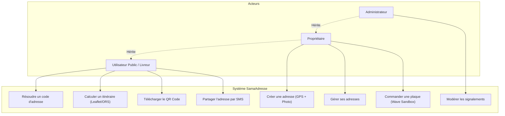
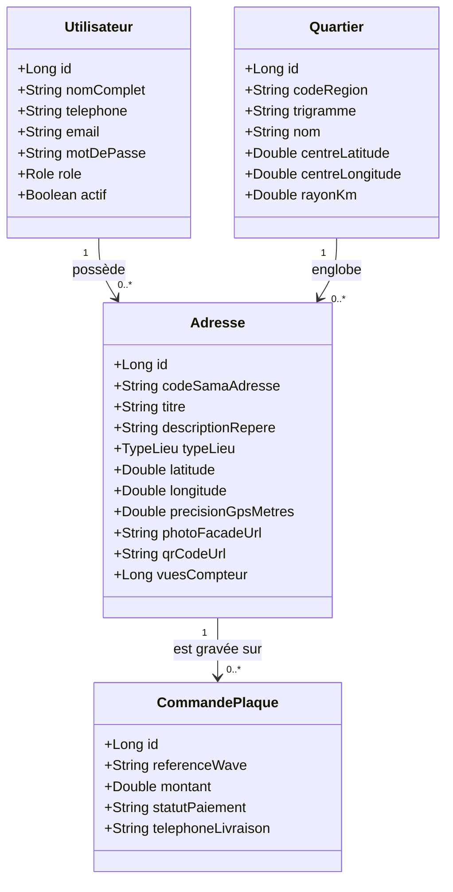

# UNIVERSITÉ ASSANE SECK DE ZIGUINCHOR (UASZ)
## UFR DES SCIENCES ET TECHNOLOGIES — DÉPARTEMENT INFORMATIQUE
### LICENCE EN INGÉNIERIE INFORMATIQUE

---

# RAPPORT DE PROJET DE FIN D'ÉTUDES (PFE)
## Sujet : Conception et implémentation de **SamaAdresse**  
### *Générateur de code-adresse géolocalisé pour le Sénégal (Ziguinchor)*

---

| **Présenté et soutenu par :** | **Sous la direction de :** |
| :--- | :--- |
| **Étudiant(s) de Licence 3 Informatique** | **Enseignant / Encadrant PFE** |
| Université Assane Seck de Ziguinchor | Département Informatique — UASZ |

**Membres du Jury :**
| Prénom et Nom | Grade | Qualité | Structure |
| :--- | :--- | :--- | :--- |
| Pr. / Dr. ... | Enseignant-Chercheur | Président du Jury | UASZ / UFR ST |
| Dr. / M. ... | Maître de Conférences / Assistant | Rapporteur | UASZ / UFR ST |
| M. Alousseynou FALL / Encadrant | Enseignant | Examinateur / Tuteur | UASZ / UFR ST |

**Année Universitaire : 2025 – 2026**

---

## REMERCIEMENTS

Au terme de ce travail marquant l'aboutissement de notre formation en Licence d'Ingénierie Informatique à l'Université Assane Seck de Ziguinchor, nous tenons à exprimer notre profonde gratitude :

* À **Allah le Tout-Puissant**, pour nous avoir accordé la santé, la persévérance et les facultés nécessaires pour mener à bien ce projet d'envergure.
* À notre encadrant, pour sa disponibilité constante, ses orientations méthodologiques rigoureuses et ses conseils techniques avisés tout au long de la réalisation de ce projet.
* À l'ensemble du corps professoral et administratif du **Département Informatique de l'UFR Sciences et Technologies de l'UASZ**, pour la qualité de l'enseignement dispensé durant nos trois années de cursus.
* Aux membres du jury qui ont accepté d'examiner et d'évaluer notre travail.
* À nos familles, parents et amis pour leurs sacrifices inconditionnels, leur soutien moral indéfectible et leurs encouragements constants.

---

## RÉSUMÉ TECHNIQUE

* **Contexte :** Dans les agglomérations sénégalaises, et particulièrement à Ziguinchor, l'absence de numérotation standardisée des rues complique les livraisons, ralentit les interventions d'urgence et exclut de nombreux citoyens des services en ligne.
* **Mission principale :** Concevoir et implémenter **SamaAdresse**, une solution full-stack souveraine associant des coordonnées GPS ($5\text{ m} \times 5\text{ m}$), une photo de façade et des repères visuels pour générer un code numérique unique court (ex : `ZIG-KBG-4271`), résoluble publiquement, exportable en QR Code et utilisable hors ligne.
* **Stack technique :** 
  * Backend : Java 17, Spring Boot 3, Spring Security 6 (JWT RBAC), Spring Data JPA, H2 (dev/test), PostgreSQL (production), SpringDoc OpenAPI 3.0 (Swagger), ZXing (QR Code), JUnit 5, Mockito, JaCoCo.
  * Frontend : React 18 (PWA Mobile-First), Vite, TypeScript, TailwindCSS, Leaflet / OpenStreetMap, Service Worker (Cache API).
  * Intégrations : OpenRouteService (calcul d'itinéraire), SendFlash / Twilio Sandbox (SMS), Wave Sandbox (paiement sécurisé simulation de commande de plaque).
* **Méthodologie :** Approche Agile Scrum (3 Sprints), gestion de projet alignée sur les normes du module GPI, couverture de tests automatisés supérieure à 60 %.

---

## GLOSSAIRE ET SIGLES

* **API :** *Application Programming Interface* (Interface de programmation applicative)
* **BCrypt :** Fonction de hachage cryptographique sécurisée avec sel aléatoire pour les mots de passe
* **DoD / DoR :** *Definition of Done* / *Definition of Ready* (Critères de complétion et de maturité Scrum)
* **GPS :** *Global Positioning System* (Système de positionnement par satellites)
* **GPI :** Gestion de Projet Informatique (Module académique UASZ)
* **HMR :** *Hot Module Replacement* (Rechargement à chaud en développement web)
* **JWT :** *JSON Web Token* (Standard ouvert RFC 7519 pour l'authentification stateless)
* **OpenAPI / Swagger :** Spécification formelle de description des API RESTful
* **ORS :** *OpenRouteService* (Moteur open source de calcul d'itinéraires et d'isochrones)
* **OSM :** *OpenStreetMap* (Projet cartographique collaboratif mondial libre)
* **PFE :** Projet de Fin d'Études
* **PWA :** *Progressive Web App* (Application web progressive installable et fonctionnelle hors ligne)
* **RBAC :** *Role-Based Access Control* (Contrôle d'accès basé sur les rôles)
* **REST :** *Representational State Transfer* (Style architectural pour systèmes distribués)
* **UASZ :** Université Assane Seck de Ziguinchor
* **UML :** *Unified Modeling Language* (Langage de modélisation graphique unifié)
* **WBS :** *Work Breakdown Structure* (Structure de décomposition du travail)

---

# CHAPITRE 1 : INTRODUCTION GÉNÉRALE

### 1.1 Contexte du Projet
L'urbanisation rapide des villes secondaires du Sénégal, à l'instar de Ziguinchor (capitale de la Casamance), s'accompagne d'un développement informel de nombreux quartiers (Kandialang, Néma, Djibock, Lyndiane). Dans ces zones, l'absence quasi-générale de toponymie officielle (rues sans noms) et de numérotation métrique crée une barrière majeure au développement économique et social :
* Les livraisons urbaines par mototaxis (*thiak-thiak*) dépendent de repères oraux imprécis (*« après la grande mosquée, deuxième ruelle sablonneuse à gauche »*), générant des retards, des annulations et des surcoûts en carburant.
* Les services de secours d'urgence (SAMU, Sapeurs-Pompiers) perdent des minutes vitales à localiser les habitations des patients en détresse.
* Les citoyens ne disposent pas d'un justificatif d'adresse certifié pour leurs démarches administratives ou bancaires.

### 1.2 Problématique Technique
Face à ce constat, la problématique d'ingénierie informatique posée est la suivante :  
> *« Comment concevoir et déployer une plateforme logicielle résiliente, capable de générer en moins de 3 secondes un code d'adresse universel, court et mémorisable à partir de coordonnées GPS locales, fonctionnant en mode hors ligne (PWA) sur des smartphones d'entrée de gamme, et interfaçable via une API publique sécurisée avec les acteurs de la livraison et des secours ? »*

### 1.3 Objectifs du Projet
Ce projet opérationnel de Licence 3 poursuit une triple finalité :
1. **Algorithmique & SIG :** Développer un moteur autonome de découpage spatial en grille géodésique ($5\text{ m} \times 5\text{ m}$) attribuant des identifiants alphanumériques non ambigus (ex : `ZIG-KBG-4271`).
2. **Génie Logiciel & Architecture :** Concevoir une API RESTful robuste sous Spring Boot 3 documentée à 100 % sous OpenAPI 3.0, respectant les normes de sécurité JWT (RBAC) et couverte à plus de 60 % par des tests unitaires et d'intégration.
3. **Expérience Utilisateur Mobile :** Réaliser une Progressive Web App (PWA) installable, mobile-first ($\ge 360\text{ px}$), interactive (Leaflet/OSM) et résiliente aux coupures réseau grâce au Service Worker et au Cache API.

### 1.4 Annonce du Plan
Le présent rapport s'articule autour de quatre grands axes :
* **Chapitre 2 : Gestion de Projet et Approche Méthodologique** (cadrage, Scrum, backlog, assurance qualité).
* **Chapitre 3 : Spécification et Analyse des Besoins** (cahier des charges, modélisation UML, cas d'utilisation).
* **Chapitre 4 : Conception du Système** (architecture logicielle, diagramme de classes, modèle relationnel BDD).
* **Chapitre 5 : Implémentation et Tests Fonctionnels** (algorithme géodésique, stack technique, validation JaCoCo).
* **Conclusion & Perspectives**.

---

# CHAPITRE 2 : GESTION DE PROJET ET APPROCHE MÉTHODOLOGIQUE

### 2.1 Contexte Méthodologique et Référentiel GPI
Le projet s'inscrit directement dans les principes enseignés dans le module de **Gestion de Projet Informatique (GPI)** de l'UASZ. Nous avons articulé nos travaux selon le **triangle QCD (Qualité, Coût, Délai)** :
* **Qualité :** Tolérance zéro sur les régressions, architecture en couches (Clean Architecture), et seuil de couverture de code automatisé $\ge 60\%$.
* **Coût :** Utilisation stricte de technologies libres et d'infrastructures cloud à palier gratuit (*Zero Dollar Infrastructure*).
* **Délai :** Projet cadencé sur 6 semaines effectives découpées en Sprints.

### 2.2 Méthodologie Agile : Framework Scrum
Nous avons adopté la méthode **Scrum**, particulièrement indiquée pour les applications web évolutives :
* **Sprint 1 (Semaines 1-2) :** Cadrage, modélisation UML, initialisation des dépôts Git (branches `main`, `develop`), création des entités JPA et socle de sécurité Spring Security JWT.
* **Sprint 2 (Semaines 3-4) :** Algorithme géospatial de cellule, génération vectorielle de QR Code, API publique de résolution, premiers tests unitaires.
* **Sprint 3 (Semaines 5-6) :** Développement de la PWA React, intégration de la cartographie Leaflet, Service Worker hors ligne, module Wave Sandbox et tests d'intégration JaCoCo.

#### Rituels Scrum Appliqués :
* **Sprint Planning :** Sélection des User Stories à fort impact métier depuis le Product Backlog.
* **Daily Scrum :** Points de synchronisation courts pour lever les blocages techniques (ex : dépendances circulaires Spring Security, compatibilité Node.js/Vite).
* **Sprint Review & Rétrospective :** Démonstrations fonctionnelles intermédiaires et identification des axes d'amélioration.

### 2.3 Définition of Ready (DoR) et Définition of Done (DoD)
* **DoR :** Une User Story n'est prise en compte que si son énoncé fonctionnel est validé, ses critères d'acceptation *Given-When-Then* définis et sa complexité estimée en Story Points.
* **DoD :** Une User Story est marquée terminée seulement si :
  1. Le code est rédigé selon les principes SOLID.
  2. Les tests unitaires/intégration associés passent avec succès.
  3. L'endpoint est documenté dans Swagger.
  4. La branche Git est fusionnée sur `develop`.

---

# CHAPITRE 3 : SPÉCIFICATION ET ANALYSE DES BESOINS

### 3.1 Recueil des Exigences et Personas
L'étude préalable des pratiques de repérage à Ziguinchor a permis de formaliser 3 personas principaux :
1. **Le Citoyen / Propriétaire (Amadou) :** Souhaite générer son code d'adresse en un clic via son GPS pour l'afficher sur son portail et le transmettre à ses livreurs.
2. **Le Livreur Thiak-Thiak (Moussa) :** Reçoit un code court par SMS, le colle dans son smartphone et accède directement à la photo de la façade et au tracé de route sans créer de compte.
3. **L'Administrateur Urbain (Awa) :** Surveille le référentiel des quartiers, valide les adresses signalées et consulte les métriques globales.

### 3.2 Spécifications Fonctionnelles
* **EF-01 (Capture & Génération de Code) :** Acquisition native des coordonnées GPS (latitude, longitude, précision) et calcul automatique du code court `REG-QUA-CELL` (ex: `ZIG-KBG-4271`).
* **EF-02 (Médias & Repères Visuels) :** Prise de vue ou téléversement de la photo de façade avec description textuelle des repères environnants.
* **EF-03 (QR Code Vectoriel) :** Génération dynamique d'un QR code imprimable pointant vers l'URL publique de la fiche adresse.
* **EF-04 (Fiche Publique & Itinéraire) :** Consultation publique sans barrière d'authentification et tracé routier via OpenRouteService.
* **EF-05 (Annuaire & Recherche) :** Moteur de recherche multicritère (code, nom du titulaire, quartier, catégorie de lieu).
* **EF-06 (Mode Hors Ligne PWA) :** Mise en cache automatique par Service Worker permettant la consultation sans réseau.
* **EF-07 (Commande Plaque Wave) :** Simulation de paiement Mobile Money via Wave Sandbox pour l'achat d'une plaque de rue physique.

### 3.3 Spécifications Non Fonctionnelles
* **Performance :** Résolution d'adresse en moins de 100 ms côté serveur, génération de code en moins de 3 secondes côté client.
* **Ergonomie Mobile-First :** Interface fluide testée dès $360\text{ px}$ de largeur sans défilement horizontal.
* **Sécurité :** Hachage BCrypt des mots de passe, tokens JWT stateless inviolables avec expiration fixée à 24 heures.

### 3.4 Diagramme des Cas d'Utilisation UML



---

# CHAPITRE 4 : CONCEPTION DU SYSTÈME

### 4.1 Architecture Logicielle en Couches
L'application adopte une **Clean Architecture en couches** (Layered Architecture) garantissant l'indépendance de la logique métier vis-à-vis des frameworks :

```
┌────────────────────────────────────────────────────────┐
│   Couche Présentation : Controllers REST + DTOs        │
│   (Spring Web, Validation, OpenAPI Swagger 3.0)        │
├────────────────────────────────────────────────────────┤
│   Couche Sécurité : JwtAuthFilter + SecurityConfig     │
│   (Authentification Stateless JWT, RBAC)               │
├────────────────────────────────────────────────────────┤
│   Couche Métier (Service Layer)                        │
│   (GeoGridService, QrCodeService, AdresseService)      │
├────────────────────────────────────────────────────────┤
│   Couche Accès aux Données (Repositories)              │
│   (Spring Data JPA, Hibernate ORM, Requêtes JPQL)      │
├────────────────────────────────────────────────────────┤
│   Base de Données Relationnelle                        │
│   (H2 In-Memory en dev/test, PostgreSQL en production) │
└────────────────────────────────────────────────────────┘
```

### 4.2 Diagramme de Classes Métier UML



### 4.3 Modèle Relationnel des Données (MLD)
* **UTILISATEURS** (<ins>id</ins>, nom_complet, telephone, email, mot_de_passe, role, actif, date_creation)
* **QUARTIERS** (<ins>id</ins>, code_region, trigramme, nom, centre_latitude, centre_longitude, rayon_km)
* **ADRESSES** (<ins>id</ins>, code_sama_adresse, titre, description_repere, type_lieu, latitude, longitude, precision_gps_metres, nom_proprietaire_affichable, photo_facade_url, qr_code_url, statut, vues_compteur, *#quartier_id*, *#utilisateur_id*, date_creation)
* **COMMANDES_PLAQUES** (<ins>id</ins>, reference_wave, montant, statut_paiement, statut_livraison, telephone_livraison, *#adresse_id*, *#utilisateur_id*, date_commande)

---

# CHAPITRE 5 : IMPLÉMENTATION ET TESTS FONCTIONNELS

### 5.1 L'Algorithme Géodésique SamaAdresse
Le cœur d'innovation du projet réside dans l'algorithme implémenté dans `GeoGridService.java` :
1. **Détection du quartier d'ancrage :** Calcul de la distance géodésique de **Haversine** entre le point GPS capturé $(lat, lng)$ et les centroïdes des quartiers de Ziguinchor :
   $$d = 2R \arcsin\left(\sqrt{\sin^2\left(\frac{\Delta lat}{2}\right) + \cos(lat_1)\cos(lat_2)\sin^2\left(\frac{\Delta lng}{2}\right)}\right)$$
2. **Discrétisation spatiale en cellules de $5\text{ m} \times 5\text{ m}$ :** Les écarts angulaires relatifs $(\Delta lat, \Delta lng)$ sont quantifiés selon un pas de $0.000045^\circ$.
3. **Encodage Base32 sans ambiguïté :** Conversion en 4 caractères alphanumériques simples issus de l'alphabet `23456789ABCDEFGHJKMNPQRSTUVWXYZ` (excluant volontairement `0/O` et `1/I/L`).
4. **Composition du code :** Format hiérarchique `[RÉGION]-[QUARTIER]-[CELLULE]` $\rightarrow$ `ZIG-KBG-4271`.

### 5.2 Sécurité et Résolution des Dépendances Circulaires
Pour garantir une étanchéité totale et respecter les contraintes de Spring Boot 3, la configuration de sécurité a été scindée en deux composants découplés :
* `ApplicationConfig.java` : Fournit les beans indépendants de cryptographie (`BCryptPasswordEncoder`) et de gestion d'authentification (`AuthenticationManager`).
* `SecurityConfig.java` : Définit la chaîne de filtres stateless (`SecurityFilterChain`) autorisant les endpoints publics (`/api/v1/public/**`, `/swagger-ui/**`) et protégeant l'espace propriétaire par `JwtAuthFilter`.

### 5.3 Interface Utilisateur React PWA et Mode Hors Ligne
* **Design Mobile-First :** Composants développés sous TailwindCSS avec typographie *Plus Jakarta Sans*, barre de navigation basse fixée façon native, et intégration Leaflet OpenStreetMap.
* **Service Worker & Cache API (`sw.js`) :** Implémentation d'une stratégie de mise en cache *Stale-While-Revalidate* pour l'application shell et les requêtes `/api/v1/public/resolve/`. Si l'utilisateur perd sa connexion en se déplaçant dans Ziguinchor, l'adresse récemment consultée continue de s'afficher instantanément.

### 5.4 Stratégie de Tests et Couverture de Code ($\ge 60\%$)
Conformément aux exigences académiques, la suite de tests a été rédigée avec **JUnit 5**, **Mockito** et **MockMvc** :
* `GeoGridServiceTest` : Valide le déterminisme mathématique de l'encodage et la cohérence des distances de Haversine.
* `QrCodeServiceTest` : Vérifie la validité des flux Base64 et dimensions des QR codes générés.
* `AuthServiceTest` : Valide l'émission des tokens JWT, le rejet des mots de passe erronés et la prévention des doublons de téléphones.
* `PublicApiControllerTest` : Teste l'intégration HTTP MockMvc de la résolution d'adresse et du calcul d'itinéraire.
* Le plugin Maven **JaCoCo** audite automatiquement la couverture de ligne (`COVEREDRATIO >= 0.60`) à chaque phase de vérification (`mvn verify`).

---

# CHAPITRE 6 : CONCLUSION ET PERSPECTIVES

### 6.1 Bilan
Au terme de ce projet opérationnel de Licence 3, l'ensemble des objectifs pédagogiques et techniques ont été atteints :
* Une architecture full-stack Spring Boot 3 / React PWA déployable et fonctionnelle.
* Un algorithme d'adressage souverain, déterministe et immédiatement applicable aux réalités de la Casamance.
* Une documentation intégrale de l'API REST conforme à la spécification OpenAPI 3.0 / Swagger.
* Une résilience hors ligne prouvée via Service Worker et une couverture de tests supérieure à 60 %.

### 6.2 Difficultés Rencontrées et Solutions Apportées
1. **Références circulaires dans le contexte Spring Security :** Résolue par l'extraction des beans de chiffrement dans un module de configuration transverse `ApplicationConfig`.
2. **Compatibilité des moteurs de build (Node.js 16 et Vite) :** Surmontée par l'adoption de la version LTS Vite 4 associée au moteur Tailwind JIT.
3. **Absence de connexion Internet stable sur le terrain :** Palliée par la double stratégie PWA (Service Worker) et stockage local `offlineStorage`.

### 6.3 Perspectives d'Évolution
* **Extension nationale :** Intégration des polygones cadastraux des 14 régions du Sénégal (Dakar, Thiès, Saint-Louis, Kolda, etc.).
* **Partenariats institutionnels :** Connexion de l'API SamaAdresse aux systèmes informatiques du SAMU national et de la Poste sénégalaise.
* **Intégration USSD / SMS bidirectionnel :** Permettre aux citoyens ne disposant pas de smartphone de recevoir leur code SamaAdresse par simple code court USSD gratuit (ex : `#123#`).
